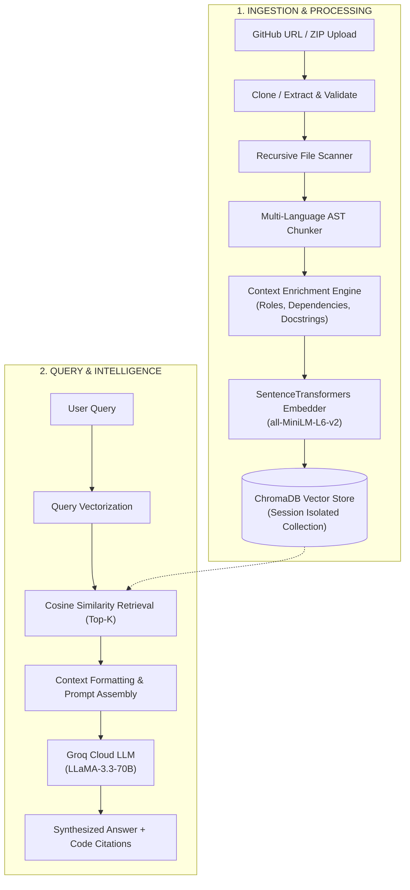

# 🔍 Repository Analysis Assistant

<div align="center">

[](https://www.python.org/)
[](https://fastapi.tiangolo.com/)
[](https://react.dev/)
[](https://vitejs.dev/)
[](https://www.trychroma.com/)
[](https://groq.com/)
[](https://www.docker.com/)
[](LICENSE)

**An intelligent codebase companion providing semantic code search, retrieval-augmented Q&A, and automated architectural analysis for any software repository.**

[Key Features](#-key-features) • [System Architecture](#-system-architecture) • [Getting Started](#-getting-started) • [API Reference](#-api-reference) • [Project Structure](#-project-directory-structure) • [License](#-license)

</div>

---

## 📖 Overview

**Repository Analysis Assistant** is an end-to-end full-stack intelligence platform built to eliminate the friction of onboarding, exploring, and navigating complex codebases. By accepting either a **public GitHub repository URL** or a **local `.zip` archive**, the system autonomously unpacks, indexes, and understands your project's codebase.

Under the hood, the system parses source files into structural syntax components (classes, methods, functions, and notebook cells), augments each chunk with domain-specific metadata and call dependencies, generates dense vector representations using **SentenceTransformers**, and indexes them within session-isolated **ChromaDB** collections. Developers can then query their repository using natural language powered by **Groq Cloud's ultra-fast LLaMA-3.3-70B** model, run semantic vector searches, generate comprehensive repository summaries, and automatically document undocumented functions.

---

## ✨ Key Features

### 🌐 Instant Ingestion & Processing
- **Direct GitHub Ingestion**: Input any public GitHub repository link; the platform performs shallow cloning, automated parsing, and indexing on the fly.
- **ZIP Archive Support**: Drag-and-drop or upload local `.zip` files of proprietary or internal projects with automatic cleanup.
- **Session Isolation**: Every upload receives a unique collection identifier (`{upload_id}_{repo_name}`), isolating data between multiple concurrent sessions.

### 🧠 Multi-Language AST Parsing & Chunking
- **Python AST Traversal**: Uses Python's native `ast` engine to accurately identify classes, functions, and methods, capturing docstrings and tracking function-call dependencies.
- **Jupyter Notebook Support**: Automatically parses `.ipynb` files, treating each execution cell as an individual chunk with complete metadata.
- **Universal Multi-Language Scanner**: Out-of-the-box support for JavaScript, TypeScript, JSX/TSX, C, C++, Java, Go, Rust, Ruby, and Markdown files.

### ⚡ Context-Enriched Vector Search & RAG
- **Structural Context Augmentation**: Automatically injects architectural role markers (e.g., *API route handlers*, *data models*, *utility helpers*, *auth layers*) into embeddings for enhanced semantic matching.
- **Dense Embeddings**: Employs `all-MiniLM-L6-v2` via SentenceTransformers for fast, 384-dimensional dense semantic vectors.
- **LLaMA-3.3-70B Powered Q&A**: Employs Retrieval-Augmented Generation (RAG) with Groq Cloud inference to answer complex architectural questions with source file and line citations.

### 📝 Automated Code Documentation & Summaries
- **AI Repository Summaries**: Generates executive overviews and architectural breakdowns by stratifying samples across distinct files, staying cleanly within token boundaries.
- **Auto-Generated Docstrings**: Inspects Python files for undocumented functions, generates Google/Sphinx style docstrings using LLM, updates source files, and dynamically re-indexes the repository.

### 🎨 Dual-Themed Modern UI
- **SaaS Light Mode**: Clean, editorial aesthetic with Instrument Serif and DM Sans typography for standard documentation and analysis workflows.
- **Hacker Dark Mode**: Cyberpunk terminal aesthetic featuring JetBrains Mono, glowing accents, and high-contrast code blocks.

---

## 🏗️ System Architecture

The following diagram illustrates the complete ingestion and retrieval pipeline:



---

## 🛠️ Tech Stack

| Component | Technology | Description |
|---|---|---|
| **Backend API** | [FastAPI](https://fastapi.tiangolo.com/) | High-performance asynchronous Python REST API |
| **Server Engine** | [Uvicorn](https://www.uvicorn.org/) | Production-grade ASGI web server |
| **LLM Inference** | [Groq Cloud](https://groq.com/) | Ultra-low latency inference using `llama-3.3-70b-versatile` |
| **Embeddings** | [SentenceTransformers](https://www.sbert.net/) | `all-MiniLM-L6-v2` dense embedding model |
| **Vector Database** | [ChromaDB](https://www.trychroma.com/) | Embedded vector store with cosine distance indexing |
| **AST Parsing** | Python `ast` module | AST traversal, docstring extraction, call-dependency mapping |
| **Frontend UI** | [React 18](https://react.dev/) + [Vite](https://vitejs.dev/) | High-speed frontend with responsive state & dual themes |
| **Containerization**| [Docker](https://www.docker.com/) | Lightweight container deployment with Python 3.11-slim & Node.js |

---

## 🚀 Getting Started

### Prerequisites

Ensure you have the following installed on your machine:
- **Python 3.10+** (Python 3.11 recommended)
- **Node.js 18+** & **npm**
- **Git**
- A free **Groq Cloud API Key** (obtainable from [Groq Console](https://console.groq.com/))

---

### Step-by-Step Installation

#### 1. Clone the Repository
```bash
git clone https://github.com/2804Chaitanya/Repository_Analysis_Assistant.git
cd Repository_Analysis_Assistant
```

#### 2. Configure Environment Variables
Copy the example environment file:
```bash
cp .env.example .env
```
Open `.env` and insert your Groq API key:
```env
GROQ_API_KEY=gsk_your_actual_groq_api_key_here
```

#### 3. Set Up Python Environment
Create and activate an isolated virtual environment:
```bash
# On macOS / Linux:
python3 -m venv venv
source venv/bin/activate

# On Windows:
python -m venv venv
venv\Scripts\activate
```
Install the required Python dependencies:
```bash
pip install -r requirements.txt
```

#### 4. Build the Frontend Client
Compile the React single-page application into production assets:
```bash
cd frontend
npm install
npm run build
cd ..
```

#### 5. Launch the Application
Start the ASGI server:
```bash
uvicorn app.main:app --reload --host 0.0.0.0 --port 8000
```

Open your browser and navigate to:
- **Web Interface**: `http://localhost:8000`
- **Interactive Swagger Docs**: `http://localhost:8000/docs`
- **ReDoc API Explorer**: `http://localhost:8000/redoc`

---

## 🐳 Docker Deployment

You can package and deploy the complete stack within a single Docker container:

```bash
# 1. Build the Docker container image
docker build -t repository-analysis-assistant .

# 2. Run container exposing port 8000
docker run -d \
  --name repo-assistant \
  -p 8000:8000 \
  -e GROQ_API_KEY="your_groq_api_key_here" \
  repository-analysis-assistant
```

Access the application in your browser at `http://localhost:8000`.

---

## 📡 API Reference

All backend routes are grouped under the `/repo` prefix:

| Method | Endpoint | Description | Request Body / Parameters |
|:---:|---|---|---|
| `POST` | `/repo/index-url` | Clone and index a public GitHub repository | `{"url": "https://github.com/user/repo"}` |
| `POST` | `/repo/upload` | Upload `.zip` archive, index, and return collection ID | `multipart/form-data` (`file`) |
| `POST` | `/repo/ask` | Ask questions across indexed codebase with RAG | `{"query": "...", "collection_name": "...", "k": 5}` |
| `POST` | `/repo/search` | Perform semantic vector search over code chunks | `{"query": "...", "collection_name": "...", "k": 5}` |
| `POST` | `/repo/summarize` | Generate AI architectural summary of the codebase | `{"collection_name": "..."}` |
| `POST` | `/repo/generate-docstrings` | Detect missing docstrings, generate, and re-index | `{"path": ".", "collection_name": "..."}` |
| `POST` | `/repo/scan` | Scan directory structure and list supported files | Query: `path` |
| `POST` | `/repo/chunk` | Chunk a specific file into functions/classes | Query: `path` |
| `GET` | `/repo/read` | Read contents of a specific file safely | Query: `path` |
| `DELETE`| `/repo/session/{upload_id}` | Clean up ChromaDB vector collections | Path: `upload_id` |
| `GET` | `/repo/health` | Service health status check | None |

### Example API Invocations

#### 1. Ingest via GitHub URL
```bash
curl -X POST "http://localhost:8000/repo/index-url" \
     -H "Content-Type: application/json" \
     -d '{"url": "https://github.com/pallets/flask"}'
```

#### 2. Query Codebase (RAG)
```bash
curl -X POST "http://localhost:8000/repo/ask" \
     -H "Content-Type: application/json" \
     -d '{
       "query": "How are route handlers registered in this framework?",
       "collection_name": "a1b2c3d4_flask",
       "k": 5
     }'
```

#### 3. Semantic Code Search
```bash
curl -X POST "http://localhost:8000/repo/search" \
     -H "Content-Type: application/json" \
     -d '{
       "query": "token verification and middleware authentication",
       "collection_name": "a1b2c3d4_flask",
       "k": 3
     }'
```

---

## 📂 Project Directory Structure

```plaintext
Repository_Analysis_Assistant/
├── .env.example                # Sample environment configuration file
├── .gitignore                  # Git ignore rules for Python, Node, Chroma
├── Dockerfile                  # Container build recipe
├── LICENSE                     # MIT License
├── README.md                   # Comprehensive project documentation
├── requirements.txt            # Python dependencies
├── app/                        # FastAPI Backend Application
│   ├── main.py                 # Lifespan manager, model pre-loader, static mount
│   ├── api/
│   │   └── repo_routes.py      # REST endpoint definitions & request handlers
│   └── services/
│       ├── repo_loader.py      # Code file discovery, language mapping & size filters
│       ├── chunker.py          # Python AST & multi-language syntax chunker
│       ├── embedder.py         # SentenceTransformers embedding model & contextual tags
│       ├── vector_store.py     # ChromaDB client, collection lifecycle & vector persistence
│       ├── llm.py              # Groq Cloud LLaMA integration & RAG prompt orchestration
│       ├── summarizer.py       # File tree builder & repo summarization engine
│       ├── git_handler.py      # Shallow Git cloning for remote repositories
│       ├── zip_handler.py      # Safe ZIP extraction & temporary storage cleanup
│       └── docstring_generator.py # AST-based docstring injector & code updater
└── frontend/                   # React + Vite Single-Page Application
    ├── index.html              # HTML entry template
    ├── package.json            # Node.js dependencies and build scripts
    ├── vite.config.js          # Vite bundler configuration
    ├── public/                 # Static assets (favicons, SVGs)
    └── src/
        ├── main.jsx            # React root mount
        ├── App.jsx             # Dual-theme interface, upload zone, Q&A console
        ├── App.css             # Supplementary styling
        └── index.css           # Global layout & baseline reset
```

---

## ⚡ Large Repository Optimizations

Large projects with hundreds or thousands of files can overwhelm vector databases and LLM context windows. This assistant implements tailored optimizations:
1. **Dynamic File Tree Truncation**: Summarizer caps file tree displays at 100 entries while providing total counts to conserve prompt tokens.
2. **Stratified Chunk Sampling**: The summarizer selects one representative chunk across diverse files (up to 15 distinct files) instead of saturating context with chunks from a single module.
3. **Chunk Batching**: Embedder batches vector operations in sizes of 16 to avoid memory exhaustion on resource-constrained hardware.
4. **Targeted Top-K Cosine Retrieval**: Only top-$k$ relevant code segments pass to the LLM context, keeping inference rapid and accurate.

---

## 🤝 Contributing

Contributions are warmly welcomed! If you'd like to improve the project:
1. **Fork** the repository
2. Create a new branch: `git checkout -b feature/AmazingFeature`
3. Commit your changes: `git commit -m 'feat: Add AmazingFeature'`
4. Push to your branch: `git push origin feature/AmazingFeature`
5. Open a **Pull Request**

---

## 📄 License

Distributed under the **MIT License**. See [`LICENSE`](LICENSE) for full details.

---

<div align="center">
Built with ❤️ for developers who love clean, understandable code.
</div>
